# Design Document

## Overview

This feature adds a self-contained promotional pop-up modal to the Araneta City public homepage (`templates/Mainpages/home.php`, served by `MainpagesController::home()` and rendered inside `templates/layout/default.php`). The modal is implemented entirely with inline PHP (for config/escaping), plain CSS, and plain JavaScript, consistent with the existing inline `<script>`/`<style>` blocks already present in `home.php` (e.g. the Happenings carousel init and the floating app widget). No new library, npm package, or admin UI is introduced in this iteration; content is defined by PHP variables at the top of `home.php`.

The modal:
- Is controlled by a single boolean "enabled" flag plus a small config array (title, message, image, CTA label/URL) defined in one place in `home.php`.
- Renders (or is entirely omitted from the HTML) based on that flag.
- Shows once per browser tab session using `sessionStorage`, degrading gracefully to "always show, never persist" if `sessionStorage` is unavailable.
- Is accessible (focus trap, `role="dialog"`, labelled, Escape-to-close, focus restoration).
- Does not interfere with the existing Happenings Swiper carousel or the floating app widget scripts.

## Architecture

```mermaid
flowchart TD
    A[MainpagesController::home&#40;&#41;] --> B[templates/Mainpages/home.php]
    B --> C{"$popupModal['enabled'] === true?"}
    C -- no --> D[No modal markup/script emitted]
    C -- yes --> E[Emit escaped modal markup + overlay]
    E --> F["Inline script: PopupModal IIFE"]
    F --> G{"DOM refs found?"}
    G -- no --> H[Abort init silently, stay hidden]
    G -- yes --> I[safeStorage.get dismissal flag]
    I --> J{"Flag === 'dismissed'?"}
    J -- yes --> H
    J -- no --> K[Show modal on DOMContentLoaded, trap focus, lock scroll]
    K --> L["Visitor dismiss action (close btn / overlay click / Escape)"]
    L --> M[Hide modal, unlock scroll, restore focus]
    M --> N[safeStorage.set dismissal flag]
```



Key architectural decisions:

- **Config in one place, rendered server-side.** All content fields live in a single PHP associative array at the top of `home.php` (Requirement 6.1). The enabled flag gates both the HTML block and the `<script>` block with a single `if`, so a disabled popup leaves zero trace in the rendered output (Requirements 1.8, 6.2, 6.3).
- **Server-side escaping and URL validation.** PHP escapes all user-visible strings with CakePHP's `h()` helper before output (Requirement 6.4), and validates the CTA URL against an allow-listed prefix (`http://`, `https://`, `/`) before deciding whether to render the CTA link at all (Requirements 6.5, 6.6). This keeps the validation logic in one pure PHP function that is easy to unit test, rather than duplicating it in JS.
- **Client-side behavior as an isolated IIFE.** The modal's JS is wrapped in its own `(function () { ... })()` block, independent of the carousel/widget scripts, so a thrown error inside it cannot stop `DOMContentLoaded` listeners registered by other scripts (Requirement 7.4). It defensively looks up all required DOM nodes first and returns early if any are missing (Requirement 7.2).
- **A safe storage wrapper.** All `sessionStorage` access goes through two small wrapper functions (`safeGet`/`safeSet`) that catch exceptions and return `null`/`false` on failure, so a blocked or quota-exceeded storage API degrades to "always show, no persistence" instead of throwing (Requirement 3.4).
- **Pure decision function for visibility.** Whether the modal should show, given a raw storage value, is a single pure function `shouldShowModal(flagValue)` returning a boolean. This isolates the only meaningfully "logic-heavy" piece of client behavior so it can be property-tested in isolation from the DOM.

## Components and Interfaces

### 1. PHP config block (`templates/Mainpages/home.php`, top of file)

```php
$popupModal = [
    'enabled' => true,
    'title'   => 'Welcome to Araneta City',
    'message' => 'Check out our latest happenings and promos.',
    'image'   => null,              // relative path under webroot/img, or null
    'ctaLabel' => 'See Happenings',
    'ctaUrl'   => '/happenings',
];
```

A small PHP helper (co-located in the same file or `AppView`) validates the CTA URL:

```php
function popupModalIsSafeUrl(?string $url): bool
{
    if ($url === null || trim($url) === '') {
        return false;
    }
    return (bool) preg_match('#^(https?://|/)#i', $url);
}
```

This single predicate covers Requirements 6.5 and 6.6 (empty/whitespace and disallowed-scheme URLs both resolve to `false`, so the template omits the CTA anchor while still rendering title/message).

### 2. Modal markup (emitted only when `$popupModal['enabled']` is true)

```html
<div id="popup-modal-overlay" class="popup-modal-overlay" hidden>
  <div id="popup-modal" class="popup-modal" role="dialog" aria-modal="true" aria-labelledby="popup-modal-title">
    <button id="popup-modal-close" class="popup-modal-close" type="button" aria-label="Close">&times;</button>
    <?php if (!empty($popupModal['image'])): ?>
      Url->image($popupModal['image'])) ?>" alt="" />
    <?php endif; ?>
    <h2 id="popup-modal-title" class="popup-modal-title"><?= h($popupModal['title']) ?></h2>
    <p class="popup-modal-message"><?= h($popupModal['message']) ?></p>
    <?php if (popupModalIsSafeUrl($popupModal['ctaUrl'] ?? null) && trim($popupModal['ctaLabel'] ?? '') !== ''): ?>
      <a id="popup-modal-cta" class="popup-modal-cta" href="<?= h($popupModal['ctaUrl']) ?>">
        <?= h($popupModal['ctaLabel']) ?>
      </a>
    <?php endif; ?>
  </div>
</div>
```

- `aria-labelledby` points at the title's `id`, satisfying Requirement 4.1.
- The close button's accessible name is the literal text "Close" via `aria-label="Close"` (Requirements 2.1, 4.6).
- The image tag has an inline `onerror` fallback handled in JS (see below) rather than an inline attribute, to keep behavior testable and CSP-friendly.
- `hidden` attribute (and matching CSS `display: none`) is the default state; JS removes it to show the modal. This guarantees the modal never flashes visible before JS runs, and that disabling JS (or JS throwing before it reaches the "show" step) leaves it hidden — supporting Requirements 1.8 and 7.2.

### 3. Modal stylesheet (inline `<style>` block near the markup, following the existing `home.php` convention of page-scoped inline styles)

- Overlay: `position: fixed; inset: 0; z-index: 1000;` — chosen to exceed the floating app widget's `z-index: 999` and the header's stacking context (Requirement 5.3).
- Modal box: `max-width` with `margin: 0 16px` equivalent spacing to satisfy the 16px minimum side margin (Requirement 5.1), `max-height: calc(100vh - 32px); overflow-y: auto;` to satisfy Requirement 5.2, and `position: fixed; top: 50%; left: 50%; transform: translate(-50%, -50%);` to stay centered on resize (Requirement 1.6).
- Colors and fonts reuse the site's existing CSS custom properties / font stack (`"Raleway", sans-serif` for headings, the body font stack, and brand colors already defined in `webroot/css/cake.css` and `webroot/css/style.css`) rather than introducing new hex values, satisfying Requirement 5.4.
- `body.popup-modal-open { overflow: hidden; }` toggled by JS to block background scroll while open (Requirement 4.7), restored on close (Requirement 4.8).

### 4. Modal script (inline `<script>` block, IIFE, placed after the markup)

Public-ish surface (all functions are internal to the IIFE; listed here for design/testability discussion):

| Function | Responsibility |
|---|---|
| `safeGet(key)` | Reads `sessionStorage`, returns `null` on any thrown error or when the key is absent. |
| `safeSet(key, value)` | Writes `sessionStorage`, swallows any thrown error, returns `true`/`false` for success. |
| `shouldShowModal(flagValue)` | Pure function: returns `true` unless `flagValue === 'dismissed'`. Treats any other value (missing, corrupted, unexpected string) as "not dismissed" (Requirements 3.2, 3.3, 3.5). |
| `getFocusableElements(root)` | Returns the ordered list of focusable elements currently inside the modal (varies with whether image/CTA are present). |
| `trapTabKey(event, root)` | Given a keydown event and the modal root, wraps Tab/Shift+Tab focus at the boundaries (Requirement 4.3). |
| `openModal()` | Removes `hidden`, locks body scroll, moves focus to the close button, records the previously focused element. |
| `closeModal(reason)` | Hides modal, unlocks scroll, calls `safeSet` to persist the dismissal flag, restores focus (to the previously-focused element if still attached, otherwise `document.body`), guarded so it only ever runs once per display cycle (Requirement 2.7). |
| `isOverlayClick(target, overlayEl, modalEl)` | Pure-ish DOM predicate: returns `true` only when the click target is the overlay itself (not a descendant of the modal content), used by the overlay click handler to decide close vs. no-op (Requirements 2.3, 2.6). |
| `init()` | Looks up all required DOM nodes; if any are missing, returns immediately without attaching listeners or throwing (Requirement 7.2). Otherwise wires up listeners and, on `DOMContentLoaded`, calls `shouldShowModal(safeGet(STORAGE_KEY))` to decide whether to call `openModal()`. |

The entire body of `init()` (and the module-level code) is wrapped in a `try { ... } catch (e) { }` so that any unexpected exception during initialization cannot propagate to the page and break the independently-registered carousel/widget `DOMContentLoaded` listeners (Requirement 7.4). The script never touches the DOM nodes owned by the carousel (`.happenings-swiper`, `.happenings-carousel-prev2/next2`) or the widget (`#floating-app-widget`), satisfying Requirement 7.5.

### 5. Interaction with existing scripts

No existing script is modified. The popup script is an additional, independent `<script>` block placed in `home.php` (not in `templates/layout/default.php`), so it only ever executes on the homepage (Requirement 1.7) and is naturally excluded from other pages that reuse `default.php`.

## Data Models

There is no database model or migration for this iteration — content is a plain PHP array literal in the template, matching the "Admin-managed content is out of scope" assumption in requirements.md. The only structured runtime data is:

**Popup config shape (PHP array, request-scoped):**
```php
[
  'enabled'  => bool,
  'title'    => string,   // 1-100 chars
  'message'  => string,   // 1-500 chars
  'image'    => ?string,  // relative image path or null
  'ctaLabel' => ?string,  // 1-50 chars or null/empty
  'ctaUrl'   => ?string,  // absolute http(s) URL, root-relative path, or null/empty
]
```

**Client-side session flag (sessionStorage):**
```
key:   "popupModalDismissed"
value: "dismissed"   // any other value/absence is treated as "not dismissed"
```

## Correctness Properties

*A property is a characteristic or behavior that should hold true across all valid executions of a system-essentially, a formal statement about what the system should do. Properties serve as the bridge between human-readable specifications and machine-verifiable correctness guarantees.*

### Property 1: Dismissal visibility decision is exact-match only

For any string value (including `undefined`/absent, empty string, the exact marker `"dismissed"`, or any other arbitrary string), `shouldShowModal(flagValue)` returns `false` if and only if `flagValue === "dismissed"`, and returns `true` for every other value.

**Validates: Requirements 3.2, 3.3, 3.5**

### Property 2: Safe storage never throws and always yields a usable result

For any mocked `sessionStorage` implementation that either behaves normally or throws on every `getItem`/`setItem` call, invoking `safeGet`/`safeSet` never raises an uncaught exception; `safeGet` returns `null` on failure and the stored value on success, and `safeSet` returns `false` on failure and `true` on success.

**Validates: Requirements 3.4**

### Property 3: Dismissal persists a recognized flag for every dismissal path

For any of the three dismissal triggers (close control, overlay click, Escape key), invoking the corresponding handler results in `safeSet` being called with the exact marker value `"dismissed"`, and a subsequent `shouldShowModal` call with that stored value returns `false`.

**Validates: Requirements 2.7, 3.1**

### Property 4: Click-target routing determines close vs. no-op

For any DOM subtree representing the overlay and modal content (with the modal containing an arbitrary number of nested descendant elements), `isOverlayClick(target, overlayEl, modalEl)` returns `true` if and only if `target === overlayEl` or `target` is an element outside `modalEl`'s subtree, and returns `false` for `target === modalEl` or any element inside `modalEl`'s subtree.

**Validates: Requirements 2.3, 2.6**

### Property 5: Focus trap wraps at both boundaries for any focusable set

For any non-empty ordered list of focusable elements inside the modal (varying in length and composition based on whether the image and CTA link are present), pressing Tab while the last element is focused moves focus to the first element, and pressing Shift+Tab while the first element is focused moves focus to the last element; for all other focus positions, Tab/Shift+Tab move focus to the adjacent element in the list.

**Validates: Requirements 4.3**

### Property 6: Focus restoration targets the prior element or falls back to body

For any element reference captured as "previously focused" before the modal opens, closing the modal moves focus to that element if it is still attached to the document, and to `document.body` if it has been detached or is otherwise absent.

**Validates: Requirements 4.4, 4.5**

### Property 7: Enabled flag exactly controls markup and script presence

For any combination of the `enabled` boolean and the other config fields (title, message, image, CTA label/URL, each independently present or absent/empty), the rendered HTML contains the popup modal markup and its `<script>` block if and only if `enabled` is `true`; when `enabled` is `false`, none of the modal markup, overlay markup, or modal script appears anywhere in the output.

**Validates: Requirements 1.8, 6.2, 6.3**

### Property 8: HTML-escaping is total over the special-character set

For any string containing an arbitrary combination and repetition of the characters `<`, `>`, `&`, `"`, `'` interspersed with arbitrary other text, rendering that string through the template's escaping path produces output in which none of those five characters appears unescaped; feeding the escaped output back through an HTML parser yields text content equal to the original string.

**Validates: Requirements 6.4**

### Property 9: CTA URL validity is determined solely by allowed prefixes

For any string used as the CTA URL (including empty string, whitespace-only strings, strings with disallowed schemes such as `javascript:` or `ftp://`, and strings beginning with `http://`, `https://`, or `/`), `popupModalIsSafeUrl(url)` returns `true` if and only if, after no trimming of interior content, the string is non-empty, not all-whitespace, and begins with one of the three allowed prefixes; the template renders the CTA anchor if and only if this predicate returns `true` (and a non-empty label is present).

**Validates: Requirements 6.5, 6.6**

### Property 10: Missing required DOM elements never crash init and never show the modal

For any subset of the modal's required DOM elements (overlay, modal box, close button, title) being absent from the document, calling `init()` does not throw, does not attach any event listeners, and leaves the modal in its default hidden state.

**Validates: Requirements 7.2**

### Property 11: Modal lifecycle never mutates unrelated existing widgets

For any sequence of open/close operations on the modal, the DOM nodes for the Happenings carousel (`.happenings-swiper` and its children) and the floating app widget (`#floating-app-widget` and its children) are present, unmodified in attributes and child structure, both before the sequence and after it.

**Validates: Requirements 7.5**

## Error Handling

- **Initialization errors**: The entire `init()` body executes inside a `try/catch`. On any exception, the modal stays `hidden`, no listeners are attached beyond what succeeded before the throw, and the error is swallowed (not rethrown), so neither the carousel's nor the widget's own `DOMContentLoaded` handlers are affected (Requirements 7.2, 7.4). Optionally logs to `console.warn` for diagnostics, never `console.error`-level uncaught.
- **Missing DOM elements**: `init()` performs all `document.getElementById`/`querySelector` lookups up front and returns early if any required node is `null`, before attaching any listeners or reading storage.
- **Storage access failures**: `safeGet`/`safeSet` wrap every `sessionStorage` call in `try/catch`; callers always receive a defined, safe value (`null` or `false`) rather than an exception, so the rest of the open/close flow behaves identically whether storage works or not — the only difference is that dismissal doesn't persist across reloads (Requirement 3.4).
- **Corrupted/unexpected storage values**: `shouldShowModal` uses strict equality against the one recognized marker string; every other value (including JSON-looking garbage, numbers-as-strings, or leftover values from a future version of this feature) is treated as "not dismissed" rather than attempting to parse or validate the value, avoiding a separate class of parse errors (Requirement 3.5).
- **Image load failures**: The modal image's `error` event handler hides the `` element (and its reserved space collapses via CSS) rather than leaving a broken-image icon, and does not block title/message from rendering (Requirement 1.4).
- **Invalid/missing CTA URL or label**: Handled entirely server-side by `popupModalIsSafeUrl` plus a non-empty-label check before the anchor tag is emitted at all — there is no CTA-related failure mode for the client script to handle, by construction.
- **Double-dismissal / re-entrancy**: `closeModal()` guards against being invoked twice for the same display (e.g., Escape pressed right after a click) using an internal `isOpen` flag, so `safeSet` isn't called redundantly and focus restoration doesn't run twice.

## Testing Strategy

**Property-based tests** (JavaScript, using a PBT library such as `fast-check`, run as part of the existing front-end/JS test tooling; minimum 100 iterations per property, each tagged with a comment referencing its design property number):

- Property 1 (dismissal decision), Property 2 (safe storage), Property 4 (click-target routing), Property 5 (focus trap wrap), Property 6 (focus restoration), Property 8 (escaping totality), Property 9 (URL validity), Property 10 (missing-element resilience), Property 11 (no mutation of other widgets) are each implemented as a single property-based test using generated strings, generated DOM fixtures, or generated boolean/config combinations as appropriate.
- Property 3 (dismissal persists) and Property 7 (enabled flag controls output) are implemented as property-based tests over PHP (using an equivalent PBT library such as `eris` for PHPUnit, or a hand-rolled randomized-input loop of ≥100 iterations if no PBT library is already in the project's `composer.json`) for Property 7's server-rendering check, and JS PBT for Property 3's client-side dismissal check.
- Tag format for each test: `// Feature: homepage-popup-modal, Property {n}: {property text}`.

**Unit / example-based tests** (PHPUnit for server-side pieces already following this project's conventions in `phpunit.xml.dist`; plain JS test runner for client-side pieces):

- `popupModalIsSafeUrl()` and the escaping path: a handful of concrete examples (valid `https://`, valid `/path`, `javascript:` scheme, empty string) as fast regression anchors alongside Property 8/9.
- Close button hit-area and accessible name: static assertion on rendered markup (dimensions via CSS, `aria-label="Close"`).
- `role="dialog"`, `aria-modal="true"`, `aria-labelledby` wiring: static assertion on rendered markup.
- Parameterized example test for the three dismissal triggers (click, Enter, Space on the close button) each independently invoking the same close path.
- Escape key closes the modal: single scenario test.
- CTA link navigates in the same tab: assert the rendered anchor has no `target="_blank"` / `rel="noopener"` override.
- Homepage-only rendering: assert another page using `templates/layout/default.php` (e.g. the News listing) does not include the modal markup.
- Integration test: `GET /` returns HTTP 200 and the response body contains the modal markup when `$popupModal['enabled']` is true (Requirement 7.3), using the project's existing CakePHP `IntegrationTestTrait`-based controller tests.
- Integration/manual checks for the non-testable visual/CSS requirements (Requirements 1.3, 1.6, 4.7, 4.8, 5.1, 5.2, 5.3 as a fixed z-index constant check, 5.4, 5.5) are covered by manual QA across breakpoints and a visual smoke check, not automated unit/property tests, since they depend on real browser layout and rendering rather than pure logic.

**Why PBT is scoped the way it is**: The feature mixes a few pure/pure-ish decision functions (visibility decision, URL validation, escaping, click-target routing, focus trap math) — all good PBT candidates with wide input spaces — with CSS/layout concerns (responsive sizing, centering, stacking, background-scroll lock) that are not expressible as "for all inputs" statements over a function's return value and are instead covered by example-based or manual/visual checks.
